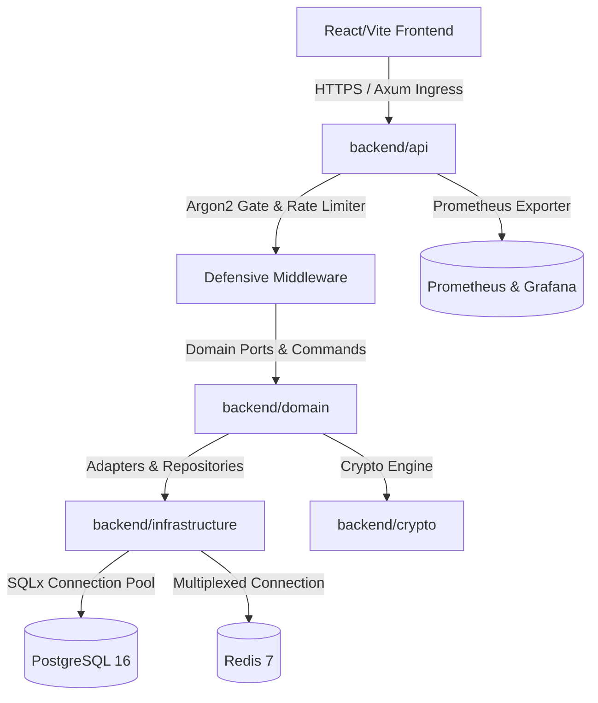

# HAS.LTD — Complete Project Summary & Architecture Overview

**HAS.LTD** is a production-grade enterprise platform combining a high-performance **Rust (Axum)** backend with a modern **React / Vite / TypeScript** frontend. It is built around **Hexagonal Architecture (Ports and Adapters)**, **Domain-Driven Design (DDD)**, and a **zero-trust, high-assurance authentication and authorization engine**.

---

## 🏗️ 1. Architecture & Technology Stack

| Subsystem                | Technology                                             | Responsibility                                                                                                                           |
| ------------------------ | ------------------------------------------------------ | ---------------------------------------------------------------------------------------------------------------------------------------- |
| **API Ingress**          | Axum 0.7, Tokio, Tower                                 | HTTP routing, RFC 7807 Problem Details, extractors, rate limiting, and metrics.                                                          |
| **Domain Core**          | Pure Rust (`no third-party web frameworks`)            | Domain models (`User`, `Session`, `Order`, `Product`), invariants, repository ports.                                                     |
| **Infrastructure**       | SQLx (PostgreSQL), `redis-rs`, S3 adapter, Resend SMTP | Database connection pooling, Redis caching, email dispatch, and distributed locking.                                                     |
| **Cryptographic Engine** | `argon2`, `ring`, `jsonwebtoken`, `aes-gcm`            | Password hashing, RS256/Ed25519 JWT signing, AES-256-GCM secret encryption, RFC 6238 TOTP.                                               |
| **Observability**        | `tracing`, `tracing-subscriber`, Prometheus, Grafana   | Dual-mode structured logging (JSON in prod, pretty in dev) with automatic secret redaction, metrics registry, alert rules, and runbooks. |
| **Frontend**             | React 18, Vite, TypeScript, Zustand                    | Storefront catalog, cart sync, checkout, role-based admin/moderator panels, auth state.                                                  |

---

## 🚀 2. Phase-by-Phase Progress & Completed Work

### **Phase 1: Database Schema & Relational Foundation**

- **Strict PostgreSQL Schema (`backend/migrations/`):**
  - **`users`**: Monotonic UUIDv7 identifiers, normalized emails, `role` (`CUSTOMER`, `MODERATOR`, `ADMIN` enforced via SQL `CHECK` constraints per ADR-001), `status` (`PENDING`, `ACTIVE`, `SUSPENDED`, `DELETED`), and monotonic `auth_version` (BIGINT) for instantaneous global session invalidation.
  - **`credentials`**: Separated Argon2id password hashes, salts, and algorithm versioning linked to `users`.
  - **`sessions`**: Tracks active devices, IP addresses, user agents, idle timeouts (30 days), absolute session caps (90 days), and `last_seen_at`.
  - **`refresh_tokens`**: Implements Token Family Refresh Rotation (`family_id`, `token_hash`, `revoked_at`, `replaced_by_id`, `expires_at`).
  - **`mfa_credentials`**: Encrypted TOTP secrets (AES-256-GCM), Argon2id-hashed recovery codes, and confirmation timestamps.
  - **`audit_log`**: Append-only tamper-evident security audit trail with structured metadata and actor tracking.

---

### **Phase 2: Cryptographic Primitives & Foundations (`backend/crypto`)**

- **Argon2id Hasher (`password.rs`):** High-security parameters (64 MB memory, 3 iterations, 1 lane). Integrated constant-time `dummy_verify()` to eliminate user enumeration timing side channels.
- **Asymmetric Token Engine (`jwt.rs`):** RS256 / Ed25519 signing using `JwtKeys` with distinct Key IDs (`kid`) supporting zero-downtime rotation. Validates `sub`, `exp`, `iat`, `nbf`, `iss`, `aud`, `auth_version`, `role`, `sid`, and token `scope` (`access` vs `mfa_pending`).
- **CSPRNG Token Utilities (`token.rs`):** Opaque token generation and constant-time SHA-256 hex digests.
- **MFA Engine (`totp.rs`):** RFC 6238 Time-based One-Time Password engine (6-digit, 30s step, $\pm 1$ step clock drift tolerance). Envelope encryption for TOTP secrets at rest via AES-256-GCM with system peppers.
- **OTP Engine (`otp.rs`):** 6-digit numeric OTP generation and Redis-backed SHA-256 hashing.

---

### **Phase 3: Behavioral Design & Threat Model Architecture**

- **Architectural Blueprint (`docs/PHASE_3_AUTH_FLOWS_DESIGN.md`):** Complete 80KB+ design specification defining security invariants:
  - **Anti-Enumeration Uniformity:** Registration and login endpoints return byte-identical response shapes and equalized execution timing.
  - **Redis Key Topology:** Strict schemas and TTLs (`auth_version:{user_id}`, `rl:*`, `otp:*`, `mfa:challenge:*`, `lock:refresh:*`).
  - **IPv6 `/64` Aggregation:** Rate-limiting keys aggregate all IPv6 clients to `/64` subnets to neutralize prefix hopping.
  - **Single-Flight Refresh Mutex:** Distributed Redis lock preventing concurrent refresh race conditions.

---

### **Phase 4: Middleware & Defense-in-Depth Layer (`backend/api/src/middleware/`)**

- **Argon2 Concurrency Gate (`argon2_gate.rs`):** Tokio semaphore-managed CPU gate (e.g. 4 concurrent permits) that buffers password hashing requests, preventing CPU starvation and HashDoS attacks. Tracks wait latency and timeouts (`auth_argon2_queue_timeout_total`).
- **Auth Guard Middleware (`auth_guard.rs`):**
  - Axum extractors: [AuthUser](file:///mnt/04469EE1469ED332/Rust_Solana/🦀Projects/Project-2026/HAS.LTD/backend/api/src/middleware/auth_guard.rs), `OptionalAuthUser`, `MfaEnrollAuthUser`, and `RequireRole`.
  - Rapid Redis cache check for `auth_version:{user_id}` (falling back to PostgreSQL).
  - Scope isolation: Rejects `mfa_pending` tokens from accessing standard API routes.
- **RFC 7807 Error Mapper (`backend/api/src/errors.rs`):** Unified error handling producing standard `application/problem+json` envelopes.

---

### **Phase 5: Session Management & Refresh Token Rotation (RTR)**

- **`POST /auth/refresh` (`handlers/session.rs`):**
  - Atomic database transaction with `FOR UPDATE` lock on the token row.
  - **15-Second Grace Window:** Accommodates mobile network dropouts:
    1. _Grace Cache Hit:_ Returns cached successor token (HTTP 200).
    2. _Replay Attack (Past Grace Window):_ Revokes entire token family, marks session revoked, increments `users.auth_version`, invalidates Redis cache, and emits `auth.session.replay_detected`.
    3. _Redis Outage Fallback:_ Returns HTTP 401 `token_invalid` without destructively revoking valid sessions.
- **`POST /auth/logout` & `POST /auth/logout-all`:** Granular single-session revocation vs. global mass logout (bumping `auth_version` and purging Redis).

---

### **Phase 6A: Email & Password Lifecycle Flows (`handlers/auth.rs`)**

- **`POST /auth/register`:** Returns HTTP 202 Accepted unconditionally. Asynchronous email dispatch via Resend adapter. Constant-time work shape matching both existing and new email paths.
- **`POST /auth/register/verify-otp` & `/resend-otp`:** 6-digit OTP verification with Redis rate-limiting and backoff curves (`rl:otp_send:{user_id}`).
- **`POST /auth/password/forgot` & `/reset`:** Non-enumerating password reset request and atomic password update with full session invalidation.
- **`POST /auth/password/change`:** In-session password change that revokes all peer sessions while keeping the calling session alive via successor token generation.

---

### **Phase 6B: Multi-Factor Authentication (MFA / TOTP) (`handlers/mfa.rs`)**

- **`POST /auth/mfa/totp/enroll`:** Issues TOTP secret + 10 Argon2id-hashed recovery codes. Prevents enrollment downgrade on already-confirmed MFA accounts (HTTP 409 Conflict).
- **`POST /auth/mfa/totp/verify`:** Confirms enrollment and activates 2FA.
- **`POST /auth/mfa/totp/disable`:** Revokes 2FA with password confirmation.
- **`POST /auth/login/totp`:** Resolves `mfa_token` challenge with single-use Redis verification (`mfa:challenge:{jti}`).
- **`POST /auth/login/recovery`:** Emergency login utilizing single-use recovery codes wrapped in a transaction with `FOR UPDATE` row-level locking.

---

### **Phase 7: Observability, Metrics, Dashboards & Runbooks**

- **Prometheus Metrics Registry (`backend/api/src/metrics.rs`):** In-memory, lockless metrics registry exposing counters, gauges, and histograms. Strictly bounded cardinality (< 63 series vs 10,000 budget).
- **Audit Event Taxonomy:** 23 frozen SIEM audit events (`auth.<subsystem>.<action>`).
- **Secret Redaction Layer (`redaction.rs`):** Tracing subscriber automatically masking 17 sensitive fields (`password`, `token`, `secret`, `pepper`, etc.) with `[REDACTED]` across both JSON and pretty formats.
- **Prometheus Alerts (`ops/alerts/auth.yml`):** 9 production alert rules (P0, P1, P2) covering token replay, Argon2 queue saturation, high 5xx/error rates, and brute-force attempts.
- **Grafana Dashboards (`ops/dashboards/`):**
  - `auth-health.json`: Ingress RPS, error rates, p95/p99 latency, DB queries, Argon2 queue depth.
  - `auth-security.json`: Failed logins, MFA failures, replay attacks, rate-limit clamps, active sessions.
- **Operational Runbooks (`docs/runbooks/`):**
  - `signing-key-rotation.md`: Zero-downtime JWT key rollover.
  - `mass-logout-incident.md`: Emergency global session invalidation.
  - `suspected-account-breach.md`: Forensic triage and containment protocol.
  - `redis-outage.md`: Operating under degraded cache conditions.
  - `postgres-failover.md`: Database failover recovery.
- **Automated Contract Tests (`observability_tests.rs`):** AST-based verification that every log field is classified and every declared metric has an active emission call site.

---

## 📊 3. Current System Verification State

| Verification Aspect      | Status                   | Details                                                                                                          |
| ------------------------ | ------------------------ | ---------------------------------------------------------------------------------------------------------------- |
| **Compilation Warnings** | **0 warnings**           | Verified across all workspace crates and tests (`--workspace --tests`).                                          |
| **Test Suites**          | **100% Passing**         | Unit, integration, concurrency, and contract tests green across `api`, `crypto`, `domain`, and `infrastructure`. |
| **Metric Cardinality**   | **63 series**            | Well within the $\le 10,000$ Prometheus timeseries budget.                                                       |
| **Audit Events**         | **23 events**            | Frozen SIEM event taxonomy completely implemented.                                                               |
| **Runbooks & Alerts**    | **5 Runbooks, 9 Alerts** | All alerts mapped directly to active markdown runbooks.                                                          |

---

## 🔜 What's Next (Phase 8)

Phase 7 is complete and validated. Phase 8 will focus on the next planned milestone (such as CI/CD deployment hardening, containerized production orchestration, or end-to-end integration with the React storefront).

Let me know when you are ready to review requirements and begin Phase 8!
