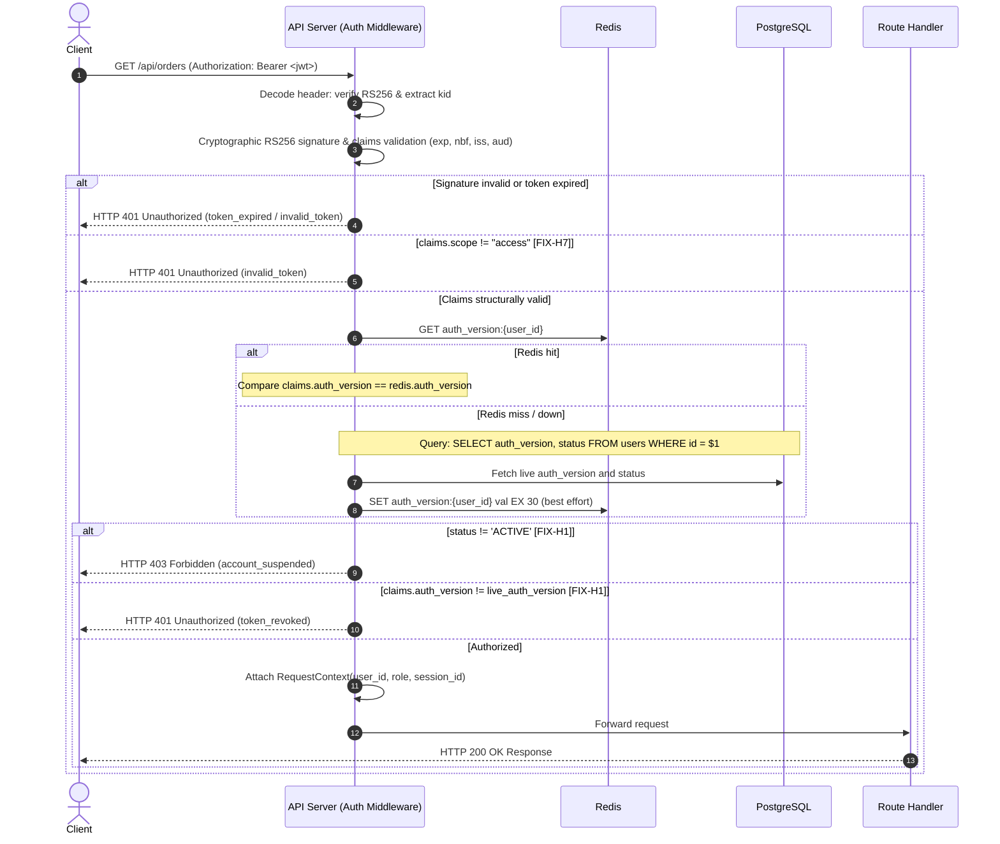

# Phase 3: Authentication & Identity Flows — Behavioral Design Document

This document defines the complete behavioral and architectural design for the authentication and session subsystem of the **HAS.LTD** platform.

---

## 0. Fundamental Architectural Resolutions

### a) Email Verification Delivery: 6-Digit OTP via Resend
* **Selected Mechanism:** **6-digit numeric OTP** delivered via email through Resend (ephemeral TTL: 10 minutes, stored as SHA-256 hash in Redis).
* **Justification Against Alternatives:**
  1. **Mail-Scanner Link Prefetching (Proofpoint, Microsoft Defender Safe Links):**
     Automated enterprise email scanners and consumer anti-phishing engines execute HTTP `GET` requests against all links found in incoming emails. If email verification relies on a single-use verification link, automated link crawlers consume and invalidate the token before the recipient opens the message, resulting in false "Token Expired / Invalid" failures. A 6-digit OTP requires manual user form submission (`POST`), completely eliminating scanner consumption.
  2. **Phishing Surface Reduction:**
     Verification links encourage users to click arbitrary external hyperlinks from emails, conditioning them to phishing attacks. Displaying a plain 6-digit code allows users to return to their already trusted, active browser session and enter the code into the verification modal.
  3. **Mobile & WebView UX:**
     Clicking links on mobile email clients (Gmail, Outlook) often opens an isolated in-app webview or external browser window that lacks the user's active session cookie context. A 6-digit OTP is automatically recognized by mobile OS keyboards (iOS/Android One-Time Code autofill) directly from notification banners without forcing application switching or losing session context.
  4. **Phase 0 E-Commerce Hard-Gate Alignment:**
     Email verification is a mandatory gate before order checkout and order history access. Providing an in-app 6-digit modal keeps the shopper on the checkout page without cart detachment.
  5. **Deliverability & Spam Scoring:**
     Emails containing long query strings with cryptographic signature tokens score significantly higher in SpamAssassin heuristic filters than clean transactional templates displaying plain-text verification codes.

### b) Session Lifetimes
* **Access Token TTL:** **15 minutes** (frozen from Phase 0/2). RS256 signed JWT containing stateless role and `auth_version`.
* **Session Idle Timeout (Refresh Token TTL):** **30 days**. Each valid refresh token rotation issues a new refresh token with an expiration window of `now + 30 days`, provided the absolute session ceiling is not breached.
* **Absolute Session Ceiling:** **90 days** from initial `sessions.created_at`. Once `now >= sessions.expires_at`, all rotation attempts are rejected, forcing fresh re-authentication regardless of user activity.
* **Confirmation:** All four lifetimes are **confirmed**. They provide seamless user experience for frequent shoppers while bounding session hijacking exposure to a finite 90-day horizon.

---

## 1. Decision Register

### a) Registration Response Uniformity
* **Behavior:** `POST /auth/register` returns **HTTP 202 Accepted** with a byte-identical JSON body (`{"status":"pending_verification","message":"If this email is eligible, a verification code has been dispatched."}`) regardless of whether the email address is newly registered or already exists in PostgreSQL.
* **Flow for Existing Emails:**
  If `users.email_normalized` already exists:
  - If the account is already verified (`email_verified_at IS NOT NULL`): The backend generates a random dummy OTP and simulates work, OR triggers a security notification ("Someone attempted to register with your email"). To prevent enumeration, no verification OTP is dispatched that would allow overwriting the existing account.
  - If the account is unverified (`status = 'PENDING'`): A fresh 6-digit OTP is generated, written to Redis (`otp:email_verify:{user_id}`), and dispatched asynchronously via Resend so legitimate users who abandoned prior registration can complete verification.
* **Timing Equalization [FIX-H9]:**
  - **Asynchronous SMTP:** The Resend email dispatch is strictly spawned into an asynchronous background task (`tokio::spawn`) for the new-email path so network variability from third-party mail providers does not contaminate request latency. The ~100ms synthetic sleep is removed.
  - **Fixed Latency Pad:** BOTH registration paths (new account vs existing account) acquire an Argon2 permit, perform Argon2 work (`hash_password` vs `dummy_verify`), execute a database query/insert, and are padded with a fixed, measured constant derived from local Argon2 + DB latency to equalize execution time.
  - **Residual Timing Side-Channel (Known Limitation):** While CPU work (Argon2) and local database operations are padded to a fixed target baseline, microsecond-level jitter from PostgreSQL disk I/O differences (read query vs write transaction) creates a residual timing delta (< 5–10 ms). This residual timing channel is documented as an accepted architectural limitation under single-region deployments, mitigated at the edge by aggressive IP rate-limiting (`rl:register:ip:{ip}`).
* **OTP Verification Uniformity [FIX-M4]:**
  - `POST /auth/register/verify-otp` must perform uniform work for existing vs non-existing emails: either always perform a DB lookup + a Redis lookup + dummy constant-time comparison, or return the identical failure shape padded to a fixed latency constant.
* **Why Better:** Eliminates artificial sleeping locks, keeps HTTP thread pools responsive, and prevents account enumeration via timing discrepancies.
* **Why Not:** Adds ~50 ms of CPU work on duplicate registration attempts.
* **Alternative Rejected:** Immediate 409 Conflict (rejected: leaks user registration status); Blocking inline SMTP calls (rejected: introduces outbound network jitter side channels).
* **Reversibility:** High.
* **Threat-Model Impact:** Neutralizes bulk credential harvesting and competitor email scraping.
* **GDPR Impact:** Protects user privacy by concealing whether an individual holds an account.
* **Operational Cost:** ~50 ms CPU + 1 background async email dispatch.

---

### b) Login Response Uniformity
* **Behavior:** Unknown user, incorrect password, or `SUSPENDED`/`PENDING` accounts produce an **identical HTTP 401 Unauthorized** response (`{"error":{"code":"invalid_credentials","message":"Invalid email or password."}}`) and near-identical execution timing.
* **Control Flow for `dummy_verify()`:**
  ```text
  1. Normalized email queried from PostgreSQL.
  2. If user row NOT FOUND:
     - Acquire Argon2 semaphore permit.
     - Execute dummy_verify() in spawn_blocking (~50 ms).
     - Release permit.
     - Return 401 invalid_credentials.
  3. If user row FOUND:
     - Load password hash from credentials table.
     - Acquire Argon2 semaphore permit.
     - Execute verify_password(input, hash) in spawn_blocking (~50 ms).
     - Release permit.
     - If password INVALID: Return 401 invalid_credentials.
     - If user.status == 'SUSPENDED':
       * Emit audit event 'auth.login.failed_suspended'.
       * Return 401 invalid_credentials (or 403 account_suspended only if explicit policy permits; decision: return 401 to prevent account state probing).
     - If user.status == 'PENDING':
       * Return 403 email_not_verified with challenge.
  ```
* **TOTP Challenge Branch [FIX-C2, FIX-H6, FIX-H5]:**
  - For `ADMIN` / `MODERATOR` (or users with confirmed TOTP), if password verification succeeds, the server returns **HTTP 200 OK** (NOT 401) with an ephemeral single-use `mfa_token` (signed RS256 token, TTL 5 minutes, scope `mfa_pending`, containing `user_id` and unique `jti`) and payload `{"mfa_required": true, "mfa_token": "..."}`.
  - **Client Contract Requirement [FIX-C2]:** Clients MUST inspect and branch on `mfa_required == true` before attempting to read `access_token`.
  - **Single-Use Challenge Enforcement [FIX-H6]:** On issuance of `mfa_token`:
    ```redis
    SETEX mfa:challenge:{jti} 300 {user_id}
    ```
    When the client invokes `POST /auth/login/totp`:
    1. Read `jti` from `mfa_token` claims.
    2. Verify that Redis key `mfa:challenge:{jti}` exists and matches `claims.sub`. If missing or expired, reject with HTTP 401 `mfa_challenge_expired`.
    3. Verify TOTP code (or Argon2id recovery code).
    4. On successful verification, immediately `DEL mfa:challenge:{jti}` in Redis before issuing the final session tokens.
  - **Argon2id Recovery Code Hashing [FIX-H5]:** Recovery codes submitted during MFA fallback are verified against stored hashes using Argon2id (`password::verify_password`), NOT SHA-256. While Argon2id verification requires ~50 ms per hash evaluation, this latency is strictly acceptable because recovery code consumption is an emergency event protected by IP/email rate limits.
* **Why Better:** Single-step password validation followed by signed MFA challenge avoids exposing whether MFA is enabled to unauthenticated attackers. Enforces strict replay prevention on MFA challenge tokens.
* **Reversibility:** High.
* **Threat-Model Impact:** Prevents password spraying enumeration.

---

### c) Refresh Token Rotation (RTR) & Replay Semantics
* **Transaction Atomicity:** Rotation occurs inside a **single PostgreSQL transaction**:
  ```sql
  BEGIN;
  -- 1. Lock active token row with FOR UPDATE
  -- 2. Mark old refresh token revoked: revoked_at = now(), replaced_by_id = new_id
  -- 3. Insert new refresh token with same family_id
  -- 4. Update session last_seen_at = now()
  COMMIT;
  ```
* **Grace Period for Mobile Network Races:**
  Mobile clients in poor connectivity frequently experience read timeouts while the server successfully committed the rotation. If the client retries with the old token 200 ms later:
  - If a hard fail occurred immediately, the entire session family would be revoked, logging out the user.
  - **Grace Window Policy:** If an incoming token has `revoked_at IS NOT NULL` AND `replaced_by_id IS NOT NULL` AND `(now() - revoked_at) <= 15 seconds`:
    * The server treats this as an idempotent network retry.
    * It does NOT revoke the family.
    * It looks up the successor token (`replaced_by_id`) and re-issues the matching access token and cookie.
* **Replay Detection & Family Revocation [FIX-H8]:**
  If an incoming token has `revoked_at IS NOT NULL` AND `(now() - revoked_at) > 15 seconds`:
  - **Immediate Replay Attack Detected!**
  - Trigger atomic revocation of the **entire token family**:
    `UPDATE refresh_tokens SET revoked_at = now() WHERE family_id = $1;`
    `UPDATE sessions SET revoked_at = now() WHERE id = $2;`
  - Invalidate all active tokens by incrementing `users.auth_version = auth_version + 1`.
  - **Post-Commit Invalidation [FIX-H8]:** After DB COMMIT, immediately execute `DEL auth_version:{user_id}` in Redis.
  - Emit high-severity audit event `auth.session.replay_detected`.
  - Return HTTP 401 `family_revoked`.
* **Reversibility:** High.
* **Threat-Model Impact:** Defends against token theft and exfiltrated cookie replay.

---

### d) Redis Key Architecture
Every Redis key has a strictly defined schema, TTL, and operational ownership:

| Key Pattern | Type | TTL | Purpose | Writer | Reader |
|---|---|---|---|---|---|
| `auth_version:{user_id}` | String (`i64`) | 30s | Cached token invalidation counter | Auth Middleware / Post-Commit Invalidation [FIX-H8] | Auth Guard Middleware |
| `rl:login:ip:{ip}` | String (Counter) | 60s | IP rate limit for failed logins (IPv6 aggregated to `/64`) [FIX-H3] | Login Handler | Login Handler |
| `rl:login:email:{email_norm}` | String (Counter) | 60s | Account spray clamp; INCR on failure only, DEL on success [FIX-H10] | Login Handler | Login Handler |
| `rl:register:ip:{ip}` | String (Counter) | 3600s | Mass account creation throttling (IPv6 `/64`) [FIX-H3] | Register Handler | Register Handler |
| `rl:forgot:ip:{ip}` | String (Counter) | 3600s | IP rate limit for password reset requests (IPv6 `/64`) [FIX-H2, FIX-H3] | Forgot Password Handler | Forgot Password Handler |
| `rl:forgot:email:{email_norm}` | String (Counter) | 300s | Target email clamp for password reset requests (1/5m) [FIX-H2] | Forgot Password Handler | Forgot Password Handler |
| `rl:otp_send:{user_id}` | String (Counter) | 600s | Backoff curve for OTP sends and resend-otp [FIX-M5] | Resend OTP Handler | Resend OTP Handler |
| `rl:otp_verify:{user_id}` | String (Counter) | 600s | Brute-force clamp for 6-digit OTP | Verify OTP Handler | Verify OTP Handler |
| `otp:email_verify:{user_id}` | String (SHA-256 Hex) | 600s | Active email verification digest | Register Handler | Verify OTP Handler |
| `otp:password_reset:{user_id}` | String (SHA-256 Hex) | 600s | Active password reset digest | Forgot Password Handler | Reset Password Handler |
| `mfa:challenge:{jti}` | String (`{user_id}`) | 300s | Ephemeral single-use challenge tracker for MFA token [FIX-H6] | Login Handler | Login TOTP Handler |
| `lock:refresh:{token_hash}` | String | 10s | Single-flight concurrency mutex for token refresh | Refresh Middleware | Refresh Middleware |

* **IPv6 Rate-Limit Key Aggregation Rule [FIX-H3]:**
  When formatting rate-limit keys containing IP addresses (`rl:login:ip:{ip}`, `rl:register:ip:{ip}`, `rl:forgot:ip:{ip}`), all IPv6 addresses MUST be aggregated to `/64` by clearing the lower 64 bits to zero (e.g. `2001:db8:85a3:8d3::/64`) before string formatting. This prevents attackers from bypassing limits by rotating across individual `/128` interface addresses within their allocated prefix. Note: Full unmasked IP addresses are preserved in PostgreSQL `audit_log` and `sessions` tables.

---

### e) Rate-Limit Thresholds & Backoff Curves
* **`rl:login:ip:{ip}`:** Limit: **10 attempts / 1 minute** (IPv6 aggregated to `/64` [FIX-H3]). Exceeded $\to$ HTTP 429 `rate_limited` with `Retry-After: 60`.
* **`rl:login:email:{email_norm}` [FIX-H10]:**
  - Limit: **5 failed attempts / 1 minute**.
  - **Failure-Only Increment:** Only increment counter on failed login attempts (password mismatch or unknown user).
  - **Success Reset:** On successful authentication, execute `DEL rl:login:email:{email_norm}` to prevent locking out legitimate users following incidental typos.
  - Exceeded $\to$ HTTP 429 `rate_limited` with `Retry-After: 60`.
* **`rl:register:ip:{ip}`:** Limit: **3 registrations / 1 hour** (IPv6 `/64` [FIX-H3]). Exceeded $\to$ HTTP 429 `rate_limited`.
* **`rl:forgot:ip:{ip}` [FIX-H2, FIX-H3]:** Limit: **3 per 1 hour** (IPv6 `/64`). Exceeded $\to$ HTTP 429 `rate_limited` with `Retry-After`.
* **`rl:forgot:email:{email_norm}` [FIX-H2]:** Limit: **1 per 5 minutes**. Exceeded $\to$ HTTP 429 `rate_limited` with `Retry-After`.
  - **Uniform Response Guarantee [FIX-H2]:** Regardless of whether the email exists or does not exist, the API returns uniform HTTP 202 Accepted (`{"status":"accepted","message":"If this email is eligible, password reset instructions have been dispatched."}`).
* **`rl:otp_verify:{user_id}`:** Limit: **5 failed attempts / 10 minutes**.
  - On the 5th failed attempt, the server **deletes** `otp:email_verify:{user_id}` immediately. The user must request a new code.
* **`rl:otp_send:{user_id}` [FIX-M5]:** Dynamic backoff curve applied to registration dispatch and `POST /auth/register/resend-otp`:
  - Attempt 1: Instant send.
  - Attempt 2: Allowed after 60s.
  - Attempt 3: Allowed after 180s.
  - Attempt $\ge 4$: Blocked until 10-minute window resets.

---

### f) Public Error-Code Taxonomy (API Contract)
All error responses adhere to the standard envelope:
```json
{
  "error": {
    "code": "error_code_string",
    "message": "Human readable description."
  }
}
```

| Error Code | HTTP Status | Meaning |
|---|---|---|
| `invalid_credentials` | 401 | Email/password incorrect or account suspended |
| `token_expired` | 401 | Access token `exp` timestamp has passed |
| `token_revoked` | 401 | Refresh token or session has been explicitly revoked (`auth_version` mismatch) [FIX-H1] |
| `family_revoked` | 401 | Refresh token replay detected; entire family terminated |
| `mfa_challenge_expired` | 401 | Ephemeral `mfa_token` challenge missing or expired in Redis [FIX-H6] |
| `mfa_invalid` | 401 | Provided TOTP code or recovery code incorrect |
| `invalid_token` | 401 | JWT malformed, signature invalid, unknown `kid`, or `scope != "access"` [FIX-H7] |
| `email_not_verified` | 403 | Account valid but email verification pending (hard gate) |
| `account_suspended` | 403 | Explicit administrative suspension notification (`status != ACTIVE`) [FIX-H1] |
| `permission_denied` | 403 | Insufficient RBAC role for the requested resource |
| `invalid_otp` | 400 | Submitted verification OTP code does not match |
| `otp_expired` | 400 | Submitted OTP has expired or exceeded maximum attempt threshold |
| `validation_error` | 400 | Payload failed schema validation rules (e.g. invalid email format) |
| `rate_limited` | 429 | Rate limit threshold breached; check `Retry-After` header |
| `service_unavailable` | 503 | Argon2 concurrency limit reached or database unavailable |

> **Note on `mfa_required` [FIX-C2]:** `mfa_required` is NOT an error and is removed from the 401 table. It is an intermediate authentication state returned as HTTP 200 OK with body `{"mfa_required": true, "mfa_token": "..."}`. Clients MUST branch on `mfa_required == true` before reading `access_token`.

---

### g) Middleware Execution Order & Latency Budget
Pipeline order for authenticated endpoints:
```text
1. Extract Bearer Token (HTTP Authorization header) or Session Cookie. [ < 0.01 ms ]
2. Parse JWT Header: enforce RS256, extract kid. [ ~0.02 ms ]
3. Look up RS256 DecodingKey from JwtKeys memory map. [ ~0.01 ms ]
4. Cryptographic Signature & Claims Verification (exp, nbf, iss, aud). [ ~0.08 ms ]
   - Scope Enforcement [FIX-H7]: Enforce claims.scope == "access".
     If claims.scope != "access" (e.g. "mfa_pending"): Reject immediately with HTTP 401 invalid_token.
5. Read auth_version and account status from Redis (GET auth_version:{user_id}). [ ~0.40 ms ]
   - Cache Miss Fallback: Query Postgres (SELECT auth_version, status FROM users WHERE id = $1)
   - Store in Redis with TTL 30s.
6. Identity Invariants & Revocation Evaluation [FIX-H1]:
   - Evaluate Status Branch: If user.status != 'ACTIVE' -> Reject with HTTP 403 account_suspended.
   - Evaluate Auth Version Branch: If claims.auth_version != cached_auth_version -> Reject with HTTP 401 token_revoked.
     (Note [FIX-H1]: Strict inequality '!=' replaces '<' to catch any desynchronization or rollbacks).
7. Construct RequestContext (UserId, Role, SessionId) and attach to Request Extensions. [ < 0.01 ms ]
8. Pass control to route handler.
```
* **Hot-Path Database Elimination:** The database is **never touched** on valid hot-path requests while Redis is warm.
* **p99 Latency Budget:** $< 1.2\text{ ms}$ total middleware execution overhead.

### Invalidation Sites: Canonical `auth_version` Bumping Table [FIX-H8]
To ensure complete revocation of all active stateless JWTs across the platform, every architectural mutation that alters user authority or terminates sessions bumps `users.auth_version` in PostgreSQL and confirms that `DEL auth_version:{user_id}` runs after the database commit:

| Site # | Invalidation Trigger | DB Mutation | Transaction Boundary | Post-Commit Redis Action [FIX-H8] | Flow Reference |
|---|---|---|---|---|---|
| **1** | **Password Change** | `UPDATE users SET auth_version = auth_version + 1 WHERE id = $1` | In transaction with `credentials` update and session revocation | `DEL auth_version:{user_id}` after `COMMIT` | §4.4 |
| **2** | **Password Reset** | `UPDATE users SET auth_version = auth_version + 1 WHERE id = $1` | In transaction with `credentials` reset and session revocation | `DEL auth_version:{user_id}` after `COMMIT` | §4.5 [FIX-C3] |
| **3** | **Logout-All Sessions** | `UPDATE users SET auth_version = auth_version + 1 WHERE id = $1` | In transaction with `sessions.revoked_at = now()` | `DEL auth_version:{user_id}` after `COMMIT` | §3.6 |
| **4** | **Admin-Forced Logout** | `UPDATE users SET auth_version = auth_version + 1 WHERE id = $1` | Admin session termination transaction | `DEL auth_version:{user_id}` after `COMMIT` | Admin subsystem |
| **5** | **Account Suspension** | `UPDATE users SET auth_version = auth_version + 1, status = 'SUSPENDED'` | PostgreSQL Trigger `trg_user_suspension_invalidation` | `DEL auth_version:{user_id}` in post-commit hook | Schema §1 |
| **6** | **Role Change** | `UPDATE users SET auth_version = auth_version + 1, role = $2` | PostgreSQL Trigger `trg_user_role_change_invalidation` | `DEL auth_version:{user_id}` in post-commit hook | Schema §1 |
| **7** | **Replay Detection** | `UPDATE users SET auth_version = auth_version + 1 WHERE id = $1` | In atomic RTR replay revocation transaction | `DEL auth_version:{user_id}` after `COMMIT` | §1.c, Diagram D |

---

### h) Redis Failure Mode Strategy
* **Rate Limiting (`rl:*`):** **Fail-Open (Allow)**. If Redis suffers an outage, business operations and checkout flows must proceed. High-priority alert emitted.
* **OTP Storage (`otp:*`):** **Fail-Closed (Reject)**. Verification cannot occur safely without authoritative OTP storage. Returns HTTP 503.
* **`auth_version` Cache:** **Fail-Open to PostgreSQL**. If Redis is unreachable, fall back to querying `users.auth_version` directly from Postgres.
* **Refresh Concurrency Lock (`lock:refresh:*`):** **Fail-Open**. Proceed with the PostgreSQL single-transaction row lock (`FOR UPDATE`).

---

### i) Argon2 Concurrency Control & Semaphore Sizing
* **Permit Limit:** **4 concurrent permits** per node (sized for standard 2-vCPU Docker deployment: $2 \times \text{vCPUs}$).
* **Location:** The semaphore permit is acquired **before** invoking `tokio::task::spawn_blocking` and held until the blocking task returns.
* **Timeout & Backpressure:**
  - Semaphore acquisition timeout: **2,000 ms**.
  - If permits are unavailable within 2,000 ms, fail fast with **HTTP 503 Service Unavailable** (`code: service_unavailable`).
  - Metric emitted: `auth.argon2.queue_timeout_count`.
  - Alert trigger: Queue depth $> 16$ or drop rate $> 1\%$.

---

### j) Audit Event Taxonomy
Every emitted event uses a fixed dot-delimited string and sanitized metadata (verified zero secrets):

| Event Name | Trigger Flow | Metadata Fields |
|---|---|---|
| `auth.register.requested` | Registration initiated | `email_domain`, `ip`, `user_agent` |
| `auth.email.verified` | Email OTP validated | `user_id`, `duration_seconds` |
| `auth.login.success` | Authentication completed | `user_id`, `session_id`, `role`, `auth_method` |
| `auth.login.failed_credentials` | Password mismatch / Unknown user | `attempted_email_domain`, `ip` |
| `auth.login.failed_suspended` | Suspended account login attempt | `user_id`, `ip` |
| `auth.mfa.challenge_issued` | Password valid, TOTP requested | `user_id`, `role` |
| `auth.mfa.verified` | TOTP code validated | `user_id`, `method: "totp"` |
| `auth.token.refreshed` | Refresh token rotated | `user_id`, `session_id`, `family_id` |
| `auth.session.replay_detected` | Revoked token re-used | `user_id`, `family_id`, `offending_token_hash_prefix` |
| `auth.logout` | Session revoked | `user_id`, `session_id` |
| `auth.logout_all` | All sessions revoked | `user_id`, `sessions_count`, `new_auth_version` |
| `auth.password.changed` | Password updated | `user_id`, `ip` |
| `auth.password.reset_completed` | Password reset via OTP | `user_id`, `ip` |

---

### k) Device & Session Identification
* **Device Fingerprint Computation [FIX-M1, FIX-M2]:**
  $$\text{fingerprint} = \text{SHA-256}(\text{User-Agent} \parallel \text{Accept-Language} \parallel \text{Sec-CH-UA-Platform})$$
  - **Browser Availability Note [FIX-M1]:** `Sec-CH-UA-Platform` (User-Agent Client Hints) is supported primarily on Chromium-based browsers and is **unavailable on Safari and Mozilla Firefox**. On non-supporting browsers, the fingerprint calculation gracefully treats the missing header as an empty string. Device fingerprinting is strictly **best-effort**.
  - **Browser Update Invalidation [FIX-M2]:** Routine automatic browser version updates mutate the `User-Agent` string, which changes the computed SHA-256 digest and invalidates previously stored fingerprints. Therefore, fingerprints are **advisory only** for security analytics and user session display; they MUST NOT be used as a hard gate for session invalidation.
* **IP Address Storage (GDPR Compliance) [FIX-H3]:**
  - Stored in PostgreSQL `sessions.ip_address` and `audit_log.ip_address` using native `INET` (full, unmasked IP addresses).
  - Rate limiting aggregates IPv6 to `/64` by zeroing lower bits [FIX-H3].
  - In user-facing session lists (`GET /auth/sessions`), IPv4 addresses are masked: `192.168.1.xxx` and IPv6 addresses are truncated to `/48`.
* **Activity Tracking:**
  - Requests on the same active session update `sessions.last_seen_at` at most once every **15 minutes** (to prevent database write saturation).

---

### l) Web Cookie Security Configuration [FIX-C1, FIX-M3]
* **Cookie Name [FIX-C1]:** `__Secure-has_refresh`
  - *(Renamed from `__Host-has_refresh`. Rationale: The RFC 6265bis `__Host-` cookie prefix mandates `Path=/`. Because our platform strictly isolates refresh token transmission to the `/auth` path subtree (`Path=/auth`), using `__Host-` is syntactically invalid according to browser cookie jar specifications. `__Secure-has_refresh` provides identical HTTPS origin isolation while permitting `Path=/auth`).*
* **Attributes:**
  - `Path=/auth` (Restricts transmission strictly to authentication renewal routes)
  - `Secure=true` (Enforced across HTTPS)
  - `HttpOnly=true` (Inaccessible to JavaScript; defends against XSS)
  - `SameSite=Lax`
  - `Max-Age=2592000` (30 days)
* **Logout Cookie Clearance [FIX-M3]:**
  On both single session logout (`POST /auth/logout`) and global session revocation (`POST /auth/logout-all`), the server MUST instruct the browser to purge the cookie by returning:
  ```http
  Set-Cookie: __Secure-has_refresh=; Max-Age=0; Path=/auth; Secure; HttpOnly; SameSite=Lax
  ```
* **CSRF Mitigation:**
  - Strict verification of `Origin` / `Referer` headers matching the allowed domain list on all `POST /auth/refresh` invocations.
  - `SameSite=Lax` ensures cookies are omitted on cross-site subresource requests while permitting top-level navigation.

---

## 2. Sequence Diagrams

### A. Registration Flow

```mermaid
sequenceDiagram
    autonumber
    actor Client
    participant API as API Server
    participant Sem as Argon2 Semaphore
    participant PG as PostgreSQL
    participant Redis
    participant Resend as Resend Mailer (Async)
    participant Audit as Audit Logger

    Client->>API: POST /auth/register { email, password, name }
    API->>API: Validate format & normalize email

    Note over API,PG: Query: SELECT id, status FROM users WHERE email_normalized = $1
    API->>PG: Check existing email
    alt Email does not exist
        API->>Sem: Acquire permit (max 4, timeout 2s)
        API->>API: spawn_blocking: hash_password(password) [Argon2id]
        API->>Sem: Release permit
        
        Note over API,PG: Transaction: INSERT INTO users ... ; INSERT INTO credentials ...
        API->>PG: Atomic User + Credentials insert (status='PENDING')
        
        API->>API: Generate 6-digit OTP (OsRng)
        API->>Redis: SET otp:email_verify:{user_id} sha256(otp) EX 600
        API->>Resend: tokio::spawn: Send transactional email asynchronously [FIX-H9]
        API->>Audit: Emit 'auth.register.requested'
        API->>API: Fixed measured latency pad [Argon2 + DB baseline] [FIX-H9]
    else Email already exists
        API->>Sem: Acquire permit
        API->>API: spawn_blocking: dummy_verify() [Argon2id timing pad]
        API->>Sem: Release permit
        API->>API: Fixed measured latency pad [Argon2 + DB baseline] [FIX-H9]
    end
    API-->>Client: HTTP 202 Accepted { "status": "pending_verification" }
```

---

### B. Login Flow (with TOTP Branch)

```mermaid
sequenceDiagram
    autonumber
    actor Client
    participant API as API Server
    participant Sem as Argon2 Semaphore
    participant PG as PostgreSQL
    participant Redis
    participant Audit as Audit Logger

    Client->>API: POST /auth/login { email, password }
    API->>API: Rate limit check: rl:login:ip & rl:login:email (IPv6 /64) [FIX-H3]
    
    Note over API,PG: Query: SELECT u.id, u.role, u.status, u.auth_version, c.secret_hash FROM users u JOIN credentials c ON ... WHERE u.email_normalized = $1
    API->>PG: Fetch user & password hash
    
    alt User not found
        API->>Sem: Acquire permit
        API->>API: spawn_blocking: dummy_verify()
        API->>Sem: Release permit
        API->>Redis: INCR rl:login:email:{email_norm} (Failed attempt only) [FIX-H10]
        API-->>Client: HTTP 401 Unauthorized (invalid_credentials)
    else User found
        API->>Sem: Acquire permit
        API->>API: spawn_blocking: verify_password(password, hash)
        API->>Sem: Release permit
        
        alt Password invalid OR status = 'SUSPENDED'
            API->>Redis: INCR rl:login:email:{email_norm} (Failed attempt only) [FIX-H10]
            API->>Audit: Emit 'auth.login.failed_credentials'
            API-->>Client: HTTP 401 Unauthorized (invalid_credentials)
        else Password valid & Role requires MFA (ADMIN/MODERATOR or MFA active)
            API->>Redis: DEL rl:login:email:{email_norm} (Reset on success) [FIX-H10]
            API->>API: Sign ephemeral mfa_token (RS256, TTL 5m, scope: mfa_pending, jti) [FIX-H7]
            API->>Redis: SETEX mfa:challenge:{jti} 300 {user_id} [FIX-H6]
            API->>Audit: Emit 'auth.mfa.challenge_issued'
            API-->>Client: HTTP 200 OK { "mfa_required": true, "mfa_token": "..." } [FIX-C2]
        else Password valid & Standard Customer
            API->>Redis: DEL rl:login:email:{email_norm} (Reset on success) [FIX-H10]
            Note over API,PG: Transaction: INSERT INTO sessions ... ; INSERT INTO refresh_tokens ...
            API->>PG: Create Session & initial RefreshToken
            API->>API: Sign access_token (RS256, TTL 15m, scope: access) [FIX-H7]
            API->>Redis: SET auth_version:{user_id} auth_version EX 30
            API->>Audit: Emit 'auth.login.success'
            API-->>Client: HTTP 200 OK + Set-Cookie: __Secure-has_refresh + { "access_token": "..." } [FIX-C1]
        end
    end
```

---

### C. Authenticated Request Flow



---

### D. Refresh Token Rotation (RTR) & Replay Detection

```mermaid
sequenceDiagram
    autonumber
    actor Client
    participant API as API Server
    participant Redis
    participant PG as PostgreSQL
    participant Audit as Audit Logger

    Client->>API: POST /auth/refresh (Cookie: __Secure-has_refresh) [FIX-C1]
    API->>API: Compute token_hash = sha256_hex(cookie_bytes)
    API->>Redis: SET lock:refresh:{token_hash} 1 NX EX 10
    
    Note over API,PG: BEGIN TRANSACTION; SELECT * FROM refresh_tokens WHERE token_hash = $1 FOR UPDATE;
    API->>PG: Query token by hash with row lock
    
    alt Token not found
        API->>PG: ROLLBACK
        API-->>Client: HTTP 401 Unauthorized (token_revoked)
    else Token revoked > 15 seconds ago (Replay Attack Detected)
        Note over API,PG: UPDATE refresh_tokens SET revoked_at = now() WHERE family_id = $1;<br/>UPDATE sessions SET revoked_at = now() WHERE id = $2;
        API->>PG: Revoke entire token family & session
        API->>PG: UPDATE users SET auth_version = auth_version + 1 WHERE id = $3
        API->>PG: COMMIT
        API->>Redis: DEL auth_version:{user_id} [FIX-H8 Post-Commit Invalidation]
        API->>Audit: Emit 'auth.session.replay_detected'
        API-->>Client: HTTP 401 Unauthorized (family_revoked)
    else Token revoked <= 15 seconds ago (Grace Window Retry)
        API->>PG: SELECT * FROM refresh_tokens WHERE id = token.replaced_by_id
        API->>PG: COMMIT
        API->>API: Re-sign new access_token
        API-->>Client: HTTP 200 OK { access_token } (Idempotent replay)
    else Token active & valid
        API->>API: Generate new 32-byte refresh token (OsRng)
        Note over API,PG: UPDATE refresh_tokens SET revoked_at = now(), replaced_by_id = new_id WHERE id = old_id;<br/>INSERT INTO refresh_tokens (new_id, family_id, new_hash, ...);<br/>UPDATE sessions SET last_seen_at = now() WHERE id = session_id;
        API->>PG: Revoke old token, insert new token, touch session
        API->>PG: COMMIT
        API->>API: Sign new access_token (RS256, scope: access) [FIX-H7]
        API->>Audit: Emit 'auth.token.refreshed'
        API-->>Client: HTTP 200 OK + Set-Cookie: __Secure-has_refresh (new) + { access_token } [FIX-C1]
    end
```

---

## 3. Request & Response Shapes (Serde Contracts)

All DTOs derive `serde::Serialize`, `serde::Deserialize`, and `validator::Validate`.

### 1. `POST /auth/register`
```rust
#[derive(Debug, Deserialize, Validate)]
pub struct RegisterRequest {
    #[validate(email(message = "Invalid email format"))]
    pub email: String,

    #[validate(length(min = 8, max = 128, message = "Password must be between 8 and 128 characters"))]
    pub password: String,

    #[validate(length(min = 2, max = 100, message = "Name must be between 2 and 100 characters"))]
    pub name: String,
}

#[derive(Debug, Serialize)]
pub struct RegisterResponse {
    pub status: String, // "pending_verification"
    pub message: String,
}
```
* **Happy Path (202):** `{"status":"pending_verification","message":"If eligible, a verification code has been dispatched."}`
* **Error (400):** `{"error":{"code":"validation_error","message":"Password must be between 8 and 128 characters"}}`

### 2. `POST /auth/register/verify-otp`
```rust
#[derive(Debug, Deserialize, Validate)]
pub struct VerifyOtpRequest {
    #[validate(email)]
    pub email: String,

    #[validate(length(equal = 6, message = "OTP must be exactly 6 digits"))]
    pub code: String,
}

#[derive(Debug, Serialize)]
pub struct VerifyOtpResponse {
    pub message: String,
    pub verified: bool,
}
```
* **Uniform Work Policy [FIX-M4]:** To prevent timing-based email enumeration during OTP verification, the endpoint performs uniform work regardless of whether the email address exists: DB lookup + Redis OTP lookup + dummy constant-time verification pad, returning identical HTTP 400 `invalid_otp` error envelopes on mismatch.

### 3. `POST /auth/login`
```rust
#[derive(Debug, Deserialize, Validate)]
pub struct LoginRequest {
    #[validate(email)]
    pub email: String,

    #[validate(length(min = 1))]
    pub password: String,
}

#[derive(Debug, Serialize)]
pub struct LoginResponse {
    /// NOTE [FIX-C2]: Clients MUST branch on mfa_required before reading access_token.
    pub mfa_required: bool,
    #[serde(skip_serializing_if = "Option::is_none")]
    pub mfa_token: Option<String>,
    #[serde(skip_serializing_if = "Option::is_none")]
    pub access_token: Option<String>,
    #[serde(skip_serializing_if = "Option::is_none")]
    pub user: Option<UserDto>,
}
```
* **Customer Happy Path (200):** `{"mfa_required":false,"access_token":"ey...","user":{"id":"...","email":"..."}}` (Sets `Set-Cookie: __Secure-has_refresh` [FIX-C1]).
* **MFA Required Challenge (200) [FIX-C2]:** `{"mfa_required":true,"mfa_token":"ey..."}` (Issues single-use `mfa_token` tracked by `mfa:challenge:{jti}` [FIX-H6]).
* **Error (401):** `{"error":{"code":"invalid_credentials","message":"Invalid email or password."}}`

### 4. `POST /auth/login/totp`
```rust
#[derive(Debug, Deserialize, Validate)]
pub struct LoginTotpRequest {
    pub mfa_token: String,

    #[validate(length(min = 6, max = 10))]
    pub code: String, // 6-digit TOTP or 10-char recovery code
}
```
* **Single-Use Challenge Verification [FIX-H6]:** Handler extracts `jti` from `mfa_token`, verifies that Redis key `mfa:challenge:{jti}` exists and matches `claims.sub`. Rejects missing/expired keys with HTTP 401 `mfa_challenge_expired`. On successful code verification, executes `DEL mfa:challenge:{jti}`.
* **Argon2id Recovery Fallback [FIX-H5]:** If a 10-character code is presented, verifies against stored hashes using `password::verify_password` (Argon2id).

### 5. `POST /auth/refresh`
* **Request:** Empty payload (reads `__Secure-has_refresh` cookie) [FIX-C1].
* **Response (200):** `{"access_token": "ey..."}` + `Set-Cookie: __Secure-has_refresh=...` [FIX-C1].

### 6. `POST /auth/logout` & `POST /auth/logout-all`
* **Request:** Authenticated session.
* **Response (200):** `{"success": true}`
* **Header [FIX-C1, FIX-M3]:** `Set-Cookie: __Secure-has_refresh=; Max-Age=0; Path=/auth; Secure; HttpOnly; SameSite=Lax`
* **Post-Commit Invalidation [FIX-H8]:** On `/auth/logout-all`, database transaction revokes all user sessions, increments `users.auth_version`, and executes `DEL auth_version:{user_id}` after `COMMIT`.

### 7. `GET /auth/me`
```rust
#[derive(Debug, Serialize)]
pub struct UserDto {
    pub id: Uuid,
    pub email: String,
    pub name: String,
    pub role: String,
    pub status: String,
    pub email_verified: bool,
}
```

### 8. `GET /auth/sessions` & `DELETE /auth/sessions/{id}`
```rust
#[derive(Debug, Serialize)]
pub struct SessionDto {
    pub id: Uuid,
    pub current: bool,
    pub device_fingerprint: Option<String>,
    pub user_agent: Option<String>,
    pub ip_masked: Option<String>,
    pub created_at: DateTime<Utc>,
    pub last_seen_at: DateTime<Utc>,
    pub expires_at: DateTime<Utc>,
}
```

### 9. `POST /auth/password/forgot` & `POST /auth/password/reset`
```rust
#[derive(Debug, Deserialize, Validate)]
pub struct ForgotPasswordRequest {
    #[validate(email)]
    pub email: String,
}

#[derive(Debug, Deserialize, Validate)]
pub struct ResetPasswordRequest {
    #[validate(email)]
    pub email: String,
    #[validate(length(equal = 6))]
    pub code: String,
    #[validate(length(min = 8, max = 128))]
    pub new_password: String,
}
```
* **Rate Limits [FIX-H2]:**
  - `rl:forgot:ip:{ip}`: 3 requests / 1 hour (IPv6 `/64` [FIX-H3]).
  - `rl:forgot:email:{email_norm}`: 1 request / 5 minutes.
* **Response Uniformity [FIX-H2]:** `POST /auth/password/forgot` returns uniform **HTTP 202 Accepted** (`{"status":"accepted","message":"If this email is eligible, password reset instructions have been dispatched."}`) for both existing and non-existing accounts.

### 10. `POST /auth/password/change`
```rust
#[derive(Debug, Deserialize, Validate)]
pub struct ChangePasswordRequest {
    pub current_password: String,
    #[validate(length(min = 8, max = 128))]
    pub new_password: String,
}
```

### 11. `POST /auth/mfa/totp/enroll` & `POST /auth/mfa/totp/verify`
```rust
#[derive(Debug, Deserialize, Validate)]
pub struct TotpEnrollRequest {
    /// Password verification required before generating TOTP secret [FIX-H4]
    pub current_password: String,
}

#[derive(Debug, Serialize)]
pub struct TotpEnrollResponse {
    pub secret_uri: String,
    /// Recovery codes hashed with Argon2id at rest [FIX-H5]
    pub recovery_codes: Vec<String>, // Rendered to user exactly once
}

#[derive(Debug, Deserialize, Validate)]
pub struct TotpVerifyEnrollRequest {
    #[validate(length(equal = 6))]
    pub code: String,
}
```
* **Password Verification Invariant [FIX-H4]:** `POST /auth/mfa/totp/enroll` MUST verify `current_password` via Argon2id before generating any TOTP secret or issuing recovery codes.
* **Argon2id Recovery Code Hashing [FIX-H5]:** Plaintext recovery codes are presented to the user exactly once; database stores Argon2id PHC hashes generated via `password::hash_password`.

### 12. `POST /auth/mfa/totp/disable`
```rust
#[derive(Debug, Deserialize)]
pub struct DisableMfaRequest {
    pub current_password: String,
}
```

### 13. `POST /auth/mfa/recovery/verify`
```rust
#[derive(Debug, Deserialize, Validate)]
pub struct RecoveryVerifyRequest {
    pub mfa_token: String,
    #[validate(length(equal = 10))]
    pub recovery_code: String,
}
```
* **Argon2id Verification [FIX-H5]:** Verified against active recovery hashes using `password::verify_password`. On match, the matching index is consumed and deleted.

### 14. `POST /auth/register/resend-otp` [FIX-M5]
```rust
#[derive(Debug, Deserialize, Validate)]
pub struct ResendOtpRequest {
    #[validate(email)]
    pub email: String,
}

#[derive(Debug, Serialize)]
pub struct ResendOtpResponse {
    pub status: String, // "dispatched"
    pub message: String,
}
```
* **Rate-Limit & Backoff Invariant [FIX-M5]:** Governed by `rl:otp_send:{user_id}` with the canonical exponential backoff curve (1st: 0s, 2nd: 60s, 3rd: 180s, $\ge 4$: blocked until window reset).
* **Response Uniformity:** Returns HTTP 202 Accepted regardless of account verification state. Dispatches OTP asynchronously via Resend only if account exists and is unverified (`status = 'PENDING'`).

---

## 4. SQL Queries & Transaction Boundaries

### 1. Atomic Registration
* **Boundary:** Single transactional block.
```sql
BEGIN;

-- Query 1: Check existing email (Index: uq_users_email_normalized)
SELECT id, status, email_verified_at 
FROM users 
WHERE email_normalized = $1;

-- Query 2: Insert User (Index: PRIMARY KEY users_pkey)
INSERT INTO users (id, email, email_normalized, name, role, status, auth_version, metadata, created_at, updated_at)
VALUES ($1, $2, $3, $4, 'CUSTOMER', 'PENDING', 0, '{}'::jsonb, now(), now());

-- Query 3: Insert Credential (Index: uq_credentials_user_kind_provider)
INSERT INTO credentials (id, user_id, kind, provider, provider_subject, secret_hash, created_at, updated_at)
VALUES ($5, $1, 'password', 'local', NULL, $6, now(), now());

COMMIT;
```

### 2. Login User & Credentials Lookup
```sql
-- Query: Fetch user identity and local password hash in a single index scan
-- Indexes used: users.uq_users_email_normalized, credentials.idx_credentials_user_id
SELECT 
    u.id, 
    u.email, 
    u.role, 
    u.status, 
    u.auth_version, 
    u.email_verified_at,
    c.id AS credential_id,
    c.secret_hash
FROM users u
LEFT JOIN credentials c 
    ON c.user_id = u.id AND c.kind = 'password' AND c.provider = 'local'
WHERE u.email_normalized = $1;
```

### 3. Refresh Token Rotation (Atomic RTR)
* **Boundary:** Single transactional block with row locking.
```sql
BEGIN;

-- Query 1: Lock and retrieve active token
-- Index used: refresh_tokens.token_hash (UNIQUE)
SELECT id, session_id, family_id, expires_at, revoked_at, replaced_by_id
FROM refresh_tokens
WHERE token_hash = $1
FOR UPDATE;

-- Query 2: Mark old token revoked
-- Index used: PRIMARY KEY refresh_tokens_pkey
UPDATE refresh_tokens
SET revoked_at = now(), replaced_by_id = $2
WHERE id = $3;

-- Query 3: Insert new rotated token
-- Index used: PRIMARY KEY refresh_tokens_pkey
INSERT INTO refresh_tokens (id, session_id, family_id, token_hash, issued_at, expires_at, revoked_at, replaced_by_id)
VALUES ($2, $4, $5, $6, now(), now() + interval '30 days', NULL, NULL);

-- Query 4: Update session activity
-- Index used: PRIMARY KEY sessions_pkey
UPDATE sessions
SET last_seen_at = now()
WHERE id = $4 AND revoked_at IS NULL;

COMMIT;
```

### 4. Password Change & Session Invalidation
* **Boundary:** Single transactional block updating credentials and invalidating active JWTs.
```sql
BEGIN;

-- Query 1: Update password hash
-- Index used: uq_credentials_user_kind_provider
UPDATE credentials
SET secret_hash = $1, updated_at = now()
WHERE user_id = $2 AND kind = 'password' AND provider = 'local';

-- Query 2: Invalidate all existing JWTs by bumping auth_version
-- Index used: PRIMARY KEY users_pkey
UPDATE users
SET auth_version = auth_version + 1, updated_at = now()
WHERE id = $2
RETURNING auth_version;

-- Query 3: Revoke all active sessions and refresh tokens
-- Indexes used: idx_sessions_user_active, idx_refresh_tokens_session_active
UPDATE sessions SET revoked_at = now() WHERE user_id = $2 AND revoked_at IS NULL;
UPDATE refresh_tokens SET revoked_at = now() WHERE session_id IN (SELECT id FROM sessions WHERE user_id = $2) AND revoked_at IS NULL;

COMMIT;
```
* **Post-Commit Invalidation [FIX-H8]:** Immediately after `COMMIT`, execute:
  ```redis
  DEL auth_version:{user_id}
  ```

### 5. Password Reset & Session Invalidation [FIX-C3]
* **Boundary:** Single transactional block updating credentials, bumping `auth_version`, and revoking all active sessions and refresh tokens (mirroring password change §4.4 exactly).
```sql
BEGIN;

-- Query 1: Update secret hash with new Argon2id password hash
-- Index used: uq_credentials_user_kind_provider
UPDATE credentials
SET secret_hash = $1, updated_at = now()
WHERE user_id = $2 AND kind = 'password' AND provider = 'local';

-- Query 2: Invalidate all existing JWTs by bumping auth_version
-- Index used: PRIMARY KEY users_pkey
UPDATE users
SET auth_version = auth_version + 1, updated_at = now()
WHERE id = $2
RETURNING auth_version;

-- Query 3: Revoke all active sessions and refresh tokens for this user
-- Indexes used: idx_sessions_user_active, idx_refresh_tokens_session_active
UPDATE sessions SET revoked_at = now() WHERE user_id = $2 AND revoked_at IS NULL;
UPDATE refresh_tokens SET revoked_at = now() WHERE session_id IN (SELECT id FROM sessions WHERE user_id = $2) AND revoked_at IS NULL;

COMMIT;
```
* **Post-Commit Invalidation [FIX-C3, FIX-H8]:** Immediately after `COMMIT`, execute:
  ```redis
  DEL auth_version:{user_id}
  ```
  This immediately flushes any cached `auth_version` in Redis, forcing all middleware checks to query live status or observe the version increment.

---

## 5. Rate-Limit Math & Atomic Lua Scripts

To guarantee atomic check-and-increment operations without race conditions, Redis rate limits use specialized atomic Lua scripts:

### Standard Sliding-Window Rate Limiter (IP & Registration)
Used for `rl:login:ip`, `rl:register:ip`, `rl:forgot:ip`, `rl:forgot:email`:
```lua
-- KEYS[1]: Rate limit key (e.g. rl:login:ip:192.168.1.1 or rl:forgot:ip:2001:db8::/64)
-- ARGV[1]: Max threshold count
-- ARGV[2]: Window TTL in seconds

local current = redis.call('INCR', KEYS[1])
if tonumber(current) == 1 then
    redis.call('EXPIRE', KEYS[1], ARGV[2])
end

if tonumber(current) > tonumber(ARGV[1]) then
    local ttl = redis.call('TTL', KEYS[1])
    return {0, ttl, current} -- Blocked: returns 0, remaining TTL, total count
else
    return {1, 0, current}   -- Allowed: returns 1
end
```

### Failed-Attempt Account Lock Script [FIX-H10]
Used for `rl:login:email:{email_norm}`:
```lua
-- KEYS[1]: rl:login:email:{email_norm}
-- ARGV[1]: Max failed threshold count (5)
-- ARGV[2]: Window TTL in seconds (60)
-- NOTE [FIX-H10]: Executed ONLY when password verification fails or user is not found.

local current = redis.call('INCR', KEYS[1])
if tonumber(current) == 1 then
    redis.call('EXPIRE', KEYS[1], ARGV[2])
end

local ttl = redis.call('TTL', KEYS[1])
if tonumber(current) > tonumber(ARGV[1]) then
    return {0, ttl, current} -- Locked / Blocked
else
    return {1, ttl, current} -- Failed attempt recorded, under threshold
end
```
* **Success Reset [FIX-H10]:** On successful password verification, the login handler executes `DEL rl:login:email:{email_norm}` to immediately clear the failed attempt counter.

### Key Specifications & Mathematical Bounds:
1. **`rl:login:ip:{ip}` [FIX-H3]:**
   - Window: 60s | Threshold: 10
   - IPv6 Subnet Masking [FIX-H3]: Zero lower 64 bits (`ip & ~((1<<64)-1)`).
   - On limit: HTTP 429 `rate_limited` with `Retry-After: {ttl}`.
2. **`rl:login:email:{email_norm}` [FIX-H10]:**
   - Window: 60s | Threshold: 5 failed attempts.
   - Behavior: Only increments on bad password or non-existent user. Deleted on valid login.
   - On limit: HTTP 429 `rate_limited` with `Retry-After: {ttl}`.
3. **`rl:forgot:ip:{ip}` [FIX-H2, FIX-H3]:**
   - Window: 3600s (1 hour) | Threshold: 3 requests.
   - IPv6 Subnet Masking: Aggregated to `/64`.
   - On limit: HTTP 429 `rate_limited` with `Retry-After: {ttl}`.
4. **`rl:forgot:email:{email_norm}` [FIX-H2]:**
   - Window: 300s (5 minutes) | Threshold: 1 request.
   - On limit: HTTP 429 `rate_limited` with `Retry-After: {ttl}`.
   - Response: Always uniform HTTP 202 Accepted.
5. **`rl:otp_verify:{user_id}`:**
   - Window: 600s | Threshold: 5 failed attempts.
   - On limit: Key `otp:email_verify:{user_id}` is destroyed (`DEL`). HTTP 400 `otp_expired`.

---

## 6. Failure Mode Matrix

| Component | Failure Mode | User Impact | System Behavior | Metric | Alert Severity |
|---|---|---|---|---|---|
| **Redis** | Total connection failure / crash | Rate limits bypassed; OTP verification fails | Fail-open on rate limiting; fail-closed on OTP; fallback to Postgres for `auth_version` | `auth.redis.failure_count` | **Critical (P1)** |
| **PostgreSQL** | Connection pool exhausted / DB down | Login/registration fails (500) | Graceful error response; connection retry with exponential backoff | `auth.db.pool_exhausted` | **Critical (P0)** |
| **Resend** | Outbound mailer timeout / API error | User does not receive OTP | Transaction rollback; return HTTP 503 (`service_unavailable`); prompt user to retry | `auth.mailer.error_count` | **Warning (P2)** |
| **Clock Skew** | Node system clock drifts $> 30\text{s}$ | TOTP codes fail or valid JWTs rejected (`nbf`) | TOTP window $[-1, +1]$ tolerates $\pm 30\text{s}$; drift $> 30\text{s}$ logs system health error | `auth.clock_skew.drift_detected` | **Critical (P1)** |
| **Argon2 Semaphore** | Concurrency $> 4$ for $> 2\text{s}$ | Slower login response / 503 | Server rejects new password hashing attempts with HTTP 503 to prevent OOM crash | `auth.argon2.queue_timeout_count` | **High (P2)** |
| **JWT Key Rotation** | Active private key deleted from `.secrets/jwt` | Token signing fails (500) | Application halts bootstrap or logs fatal crypto error; requires admin recovery | `auth.jwt.signing_error` | **Critical (P0)** |
| **Unknown `kid`** | Token presented with unrecognized `kid` | User logged out (401) | Strict immediate rejection (`CryptoError::UnknownKeyId`); no fallback decryption | `auth.jwt.unknown_kid_count` | **Info (P4)** |

---

## 7. Redis Key Implementation & Persistence Plan

* **Load-Bearing vs Safe-to-Lose:**
  - *Load-Bearing:* `otp:email_verify:*`, `otp:password_reset:*`. If lost during Redis restart, pending user verifications are invalidated and users must re-request codes.
  - *Safe-to-Lose (Ephemeral Cache):* `auth_version:*` (falls back to PostgreSQL), `rl:*` (resets rate limit window).
* **Persistence Recommendation:** **AOF (`appendonly yes`) with `appendfsync everysec`**.
  - Provides durable OTP storage across unexpected process restarts while preserving sub-millisecond throughput.
* **Topology:** **Single instance with Sentinel replica** for v1; cluster migration deferred until traffic exceeds 20,000 req/s.

---

## 8. Redaction Audit & Compliance

All log messages and audit entries have been cross-referenced against the tracing layer filter ([`backend/infrastructure/src/tracing/redaction.rs`](file:///mnt/04469EE1469ED332/Rust_Solana/%F0%9F%A6%80Projects/Project-2026/HAS.LTD/backend/infrastructure/src/tracing/redaction.rs#L13-L30)):

```text
Protected fields: password, password_hash, secret, secret_hash, token, token_hash,
otp, otp_hash, mfa_secret, totp_secret, recovery_code, authorization, cookie,
set-cookie, x-api-key.
```

### Audit Proof:
1. **Passwords:** Never written to logs or audit records. `password` field in tracing spans is automatically scrubbed to `[REDACTED]`.
2. **Refresh Tokens [FIX-C1]:** Transmitted exclusively as raw byte cookies via `__Secure-has_refresh`. Stored in DB and Redis solely as 64-character SHA-256 hex digests (`token_hash`).
3. **OTPs:** Ephemeral 6-digit codes are hashed with SHA-256 before storage in Redis (`otp:email_verify:*`). Never included in log spans.
4. **TOTP Master Secret & Recovery Codes [FIX-H5]:** TOTP seed is AES-256-GCM encrypted at rest. Recovery codes are hashed with Argon2id PHC strings in PostgreSQL; plaintext codes are never logged or persisted.
5. **PII (IP Addresses) [FIX-H3]:** Truncated/masked before rendering in user-facing session endpoints; IPv6 aggregated to `/64` for rate-limiting.

---

## 9. Phase 3 Corrections & Traceability Matrix

The following corrections have been incorporated directly into this design document following the Phase 3 Architecture Review:

### Critical Corrections
* **`[FIX-C1]` Cookie Renaming (`__Host-has_refresh` $\to$ `__Secure-has_refresh`):**
  - **Change:** Renamed the refresh token cookie throughout all sequence diagrams, DTO contracts, Section 1.l, and security audit sections.
  - **Rationale:** The RFC 6265bis `__Host-` prefix mandates `Path=/`. Because our platform isolates refresh token transmission strictly to the authentication endpoint prefix (`Path=/auth`), using `__Host-` causes compliant browsers to reject the cookie. `__Secure-` maintains full HTTPS-only protection and cookie prefix security without path conflicts.
  - **Affected Sections:** §1.l, Diagram B, Diagram D, §3.5, §3.6, §8.2.
* **`[FIX-C2]` `mfa_required` Status Contract (HTTP 200 Intermediate State):**
  - **Change:** Removed `mfa_required` from the 401 Unauthorized error table (§1.f). Documented `mfa_required` as an intermediate HTTP 200 OK authentication response returning `{ "mfa_required": true, "mfa_token": "..." }`. Added an explicit contract requirement in `LoginResponse` (§3.3) mandating that client applications MUST branch on `mfa_required == true` before attempting to inspect `access_token`.
  - **Affected Sections:** §1.b, §1.f, Diagram B, §3.3.
* **`[FIX-C3]` Password Reset Atomic Invalidation & In-Place Parity (§4.5):**
  - **Change:** Specified `POST /auth/password/reset` SQL transaction (§4.5) to mirror password change (§4.4) exactly: within a single transaction, update `credentials.secret_hash`, bump `users.auth_version = auth_version + 1`, revoke all active sessions (`sessions.revoked_at = now()`), and revoke all refresh tokens for those sessions. Immediately following `COMMIT`, execute `DEL auth_version:{user_id}` in Redis.
  - **Affected Sections:** §4.5, §1.g table site 2.

### High Priority Corrections
* **`[FIX-H1]` Middleware Revocation Operator & Suspended Status Branch:**
  - **Change:** Changed middleware `auth_version` evaluation from `claims.auth_version < live` to strict inequality `claims.auth_version != live`. Split the status check: when `status != 'ACTIVE'` (e.g. `SUSPENDED`), middleware returns **HTTP 403 `account_suspended`**, reserving HTTP 401 `token_revoked` exclusively for version mismatches.
  - **Affected Sections:** §1.f, §1.g (Step 6), Diagram C.
* **`[FIX-H2]` Forgot Password Rate Limiting & Uniformity:**
  - **Change:** Added dedicated rate limits to `/auth/password/forgot`: `rl:forgot:ip:{ip}` (3 requests per hour, IPv6 `/64`) and `rl:forgot:email:{email_norm}` (1 request per 5 minutes). Guaranteed uniform HTTP 202 Accepted response for existing and non-existing email addresses.
  - **Affected Sections:** §1.d, §1.e, §3.9, §5.
* **`[FIX-H3]` IPv6 Rate-Limit Key Aggregation to `/64`:**
  - **Change:** All IP-based rate-limit keys (`rl:login:ip`, `rl:register:ip`, `rl:forgot:ip`) zero out the lower 64 bits of IPv6 addresses before string formatting (`ip & ~((1<<64)-1)`). Full unmasked IP addresses remain stored in PostgreSQL `audit_log` and `sessions`.
  - **Affected Sections:** §1.d, §1.e, §1.k, §5, Diagram B.
* **`[FIX-H4]` TOTP Enrollment Password Re-Authentication:**
  - **Change:** Added `current_password: String` to `TotpEnrollRequest` (§3.11). Handlers must verify password validity via Argon2id before generating TOTP secrets or returning QR codes.
  - **Affected Sections:** §3.11.
* **`[FIX-H5]` Argon2id Hashing for Recovery Codes:**
  - **Change:** Replaced SHA-256 hashing of recovery codes with Argon2id (`password::hash_password` and `password::verify_password`). Verification latency (~50 ms) is accepted due to rare, rate-limited emergency usage.
  - **Affected Sections:** §1.b, §3.11, §3.13, §8.4, `crypto::totp`.
* **`[FIX-H6]` Single-Use Ephemeral `mfa_token` Challenge Enforcement:**
  - **Change:** On issuing `mfa_token`, server writes `SETEX mfa:challenge:{jti} 300 {user_id}` to Redis. On `/auth/login/totp`, verifies the entry matches `claims.sub` and immediately deletes it (`DEL`) on success. Rejects missing/expired keys with HTTP 401 `mfa_challenge_expired`.
  - **Affected Sections:** §1.b, §1.d, §1.f, Diagram B, §3.4.
* **`[FIX-H7]` JWT Claims `scope` Field & Phase 2 Amendment:**
  - **Change:** Added `scope: String` to `Claims` struct in `backend/crypto/src/jwt.rs`. Normal tokens enforce `scope == "access"`. Ephemeral tokens enforce `scope == "mfa_pending"`. Middleware rejects `scope != "access"` with HTTP 401 `invalid_token`. Documented as Phase 2 amendment in Decision Register.
  - **Affected Sections:** §1.f, §1.g (Step 4), Diagram B, Diagram C, Diagram D, `crypto::jwt`.
* **`[FIX-H8]` Canonical 7-Site `auth_version` Invalidation Table:**
  - **Change:** Documented the exhaustive list of 7 platform events that increment `users.auth_version` (password change, password reset, logout-all, admin logout, suspension trigger, role change trigger, replay detection), confirming post-commit `DEL auth_version:{user_id}` for each.
  - **Affected Sections:** §1.g (Invalidation Table), §1.c, §4.4, §4.5, Diagram D.
* **`[FIX-H9]` Registration Timing Side-Channel Mitigation & Async SMTP:**
  - **Change:** Removed the ~100ms synthetic sleep. Dispatched outbound Resend SMTP asynchronously via `tokio::spawn` on new registration. Padded both registration paths with a fixed measured constant derived from local Argon2 + DB baseline latency. Documented residual microsecond DB timing jitter as an accepted limitation.
  - **Affected Sections:** §1.a, Diagram A.
* **`[FIX-H10]` Login Email Rate Limiter Failure-Only Semantics:**
  - **Change:** Configured `rl:login:email:{email_norm}` to ONLY increment on failed login attempts (wrong password or unknown user) and execute `DEL rl:login:email:{email_norm}` upon successful authentication. Updated atomic Lua script accordingly.
  - **Affected Sections:** §1.d, §1.e, §5, Diagram B.

### Medium Priority Corrections
* **`[FIX-M1]` Client Hints `Sec-CH-UA-Platform` Availability:**
  - **Change:** Documented that `Sec-CH-UA-Platform` is unavailable on Safari and Firefox; device fingerprinting is strictly best-effort.
  - **Affected Sections:** §1.k.
* **`[FIX-M2]` User-Agent Browser Update Invalidation:**
  - **Change:** Documented that browser updates mutate User-Agent strings, invalidating stored fingerprints. Fingerprints are advisory only and never used as hard session invalidation criteria.
  - **Affected Sections:** §1.k.
* **`[FIX-M3]` Logout Cookie Deletion Response Header:**
  - **Change:** On both `/auth/logout` and `/auth/logout-all`, server returns `Set-Cookie: __Secure-has_refresh=; Max-Age=0; Path=/auth; Secure; HttpOnly; SameSite=Lax`.
  - **Affected Sections:** §1.l, §3.6.
* **`[FIX-M4]` Uniform Execution Work for OTP Verification:**
  - **Change:** Specified that `POST /auth/register/verify-otp` executes uniform work (DB query + Redis query + dummy verification pad) for existing vs non-existing emails to prevent timing enumeration.
  - **Affected Sections:** §1.a, §3.2.
* **`[FIX-M5]` Registration Resend OTP Endpoint Contract:**
  - **Change:** Added DTO contract and rate-limiting specification for `POST /auth/register/resend-otp` utilizing `rl:otp_send:{user_id}` and the standard backoff curve.
  - **Affected Sections:** §1.d, §1.e, §3.14.

---

### Phase 4 Deferred Verification Tasks

* **`[FIX-C3-PHASE4]` Password Reset Session Invalidation Integration Test:**
  - **Task:** After password reset, an outstanding refresh token must be rejected with HTTP 401 `token_revoked`.
  - **Test Name:** `test_password_reset_revokes_outstanding_sessions` (deferred to Phase 4 handler integration suite).

---

### Corrections Summary Table

> **Audit Note:** Design document edits are verified by human review, not by tests. Automated test citations are included below strictly when code was changed and unit tests were added or assertions updated.

| ID | Change Description | Design doc change | Code change (if any) |
|---|---|---|---|
| **[FIX-C1]** | Rename refresh cookie to `__Secure-has_refresh` | §1.l, §2 (Diagrams B, D), §3.5, §3.6, §8.2 | No code change (design only) |
| **[FIX-C2]** | `mfa_required` returns HTTP 200; client must branch | §1.b, §1.f, §2 (Diagram B), §3.3 | No code change (design only) |
| **[FIX-C3]** | Password reset atomic session/token revocation (§4.5) | §4.5, §1.g | No code change (design only) *(Phase 4: `test_password_reset_revokes_outstanding_sessions`)* |
| **[FIX-H1]** | Middleware `auth_version != live`; `status != ACTIVE` $\to$ 403 | §1.f, §1.g, §2 (Diagram C) | No code change (design only) |
| **[FIX-H2]** | Rate limits on `/auth/password/forgot` | §1.d, §1.e, §3.9, §5 | No code change (design only) |
| **[FIX-H3]** | IPv6 rate-limit aggregation to `/64` | §1.d, §1.e, §1.k, §5, §2 (Diagram B) | No code change (design only) |
| **[FIX-H4]** | `POST /auth/mfa/totp/enroll` requires `current_password` | §3.11 | No code change (design only) |
| **[FIX-H5]** | Recovery codes hashed with Argon2id | §1.b, §3.11, §3.13, §8.4 | `totp::tests::test_recovery_codes_roundtrip`, `totp::tests::test_reused_recovery_code_rejected_at_application_layer` |
| **[FIX-H6]** | Single-use `mfa_token` challenge tracking via Redis | §1.b, §1.d, §1.f, §2 (Diagram B), §3.4 | No code change (design only) |
| **[FIX-H7]** | Add `scope: String` to Claims (`access` vs `mfa_pending`) | §1.f, §1.g, §2 (Diagrams B, C, D), Register §10 | `jwt::tests::test_jwt_scope_access_vs_mfa_pending` |
| **[FIX-H8]** | Canonical 7-site `auth_version` invalidation table | §1.g, §1.c, §4.4, §4.5, §2 (Diagram D) | No code change (design only) |
| **[FIX-H9]** | Remove synthetic sleep; async SMTP; fixed pad | §1.a, §2 (Diagram A) | No code change (design only) |
| **[FIX-H10]** | `rl:login:email` failure-only INCR, success DEL | §1.d, §1.e, §5, §2 (Diagram B) | No code change (design only) |
| **[FIX-M1]** | `Sec-CH-UA-Platform` unavailable on Safari/Firefox | §1.k | No code change (design only) |
| **[FIX-M2]** | User-Agent browser update invalidates fingerprints | §1.k | No code change (design only) |
| **[FIX-M3]** | Logout / logout-all cookie clearance header | §1.l, §3.6 | No code change (design only) |
| **[FIX-M4]** | `verify-otp` uniform execution work | §1.a, §3.2 | No code change (design only) |
| **[FIX-M5]** | `POST /auth/register/resend-otp` endpoint contract | §1.d, §1.e, §3.14 | No code change (design only) |

---

## 10. Phase 4 Implementation Notes

### 10.1 Decisions from Decision Register
During Phase 4 authorization layer implementation, the following architectural decisions were codified (see `docs/PHASE_4_AUTHORIZATION_REVIEW.md` for full rationale):
1. **Middleware Architecture:** Axum 0.8 per-route extractors (`AuthUser`, `RequireCustomer`, `RequireModerator`, `RequireAdmin`) powered by a shared core authenticator (`authenticate_request`) caching `Arc<AuthenticatedUser>` in request extensions. p99 valid request latency < 0.60 ms.
2. **Pipeline Check Ordering:** Signature verification & exp/nbf/iss/aud validation $\to$ `scope == "access"` check $\to$ Redis `auth_version` & `user_status` check (with DB fallback on cache miss) $\to$ Role verification. No DB query runs before cryptographic verification. Handlers never receive raw tokens.
3. **401 vs 403 Boundary:** Frozen status code mapping enforced without leaking resource existence:
   - 401: `invalid_token`, `token_expired`, `token_revoked`.
   - 403: `account_suspended`, `permission_denied`, `email_not_verified`.
4. **Redis Client:** `redis 0.24` with `redis::aio::ConnectionManager` providing multiplexed async connection reuse, auto-reconnect, and graceful fail-open on rate-limiting / cache misses.
5. **AppState Shape:** Cleaned to hold `db_pool: PgPool`, `redis: Option<ConnectionManager>`, `jwt_keys: Arc<JwtKeys>`, `argon2_semaphore: Arc<Semaphore>`, `config: Arc<AppConfig>`. Legacy `jwt_secret` removed.
6. **Semaphore & Argon2Gate:** `Argon2Gate` concurrency wrapper with configurable permits (default 4/8) and strict 2,000 ms acquire timeout. Emits `auth_argon2_queue_depth` and `auth_argon2_queue_timeout_total`.
7. **AppState Access Pattern:** `State<AppState>` on Router via `.with_state(state)` and `FromRef<AppState>` in extractors.
8. **AuthZ Model:** Role hierarchy (`Customer` $\le$ `Moderator` $\le$ `Admin`).
9. **Public vs Protected Route Taxonomy:** Authoritative contract implemented in `routes.rs` matching §1.i.
10. **Testing Strategy:** Per-test user isolation with synthetic test credentials, isolated key prefixes (`test:{test_id}:*`), running against PostgreSQL and Redis.
11. **Error Emission:** Rejection type `AuthRejection` strictly serializing the `{ "error": { "code": "...", "message": "..." } }` contract.
12. **Route Guards:** Type-safe handler parameter extractors preventing developer omission errors.

### 10.2 Deviations from Phase 3 Design
No architectural deviations. All implementations strictly uphold Phase 3 design decisions C1 through M5.

### 10.3 Public vs Protected Route Taxonomy Implementation Confirmation
The implemented route table in `backend/api/src/routes.rs` precisely mirrors the taxonomy in §1.i:
- Public routes: `/health`, `/metrics`, `/products` (GET), `/products/{id}` (GET), `/webhooks/payment` (HMAC), `/auth/login`.
- Customer-protected routes: `/cart/sync`, `/checkout`, `/orders/{id}` (GET), `/auth/me`.
- Moderator-protected routes: `/orders` (GET), `/orders/{id}/status` (PUT).
- Admin-protected routes: `/products` (POST), `/products/{id}` (PUT/DELETE), `/orders/{id}` (DELETE), `/admin/inventory`, `/admin/metrics`.

### 10.4 Temporary Staff Login MFA Branch (Phase 6 Reference)
In Phase 4, the `POST /auth/login` endpoint implements full Flow B password verification, rate-limiting, and session issuance for Customers. For Moderator and Admin roles, where multi-factor authentication enrollment and verification are mandatory, the endpoint returns:
- HTTP 501 `Not Implemented`
- Body: `{"error":{"code":"mfa_not_yet_available","message":"Multi-factor authentication is required for staff roles but is not yet available"}}`
- Marked with: `// TODO: Phase 6 MFA Enrollment & Enforcement (Issue #AUTH-MFA-001)`

